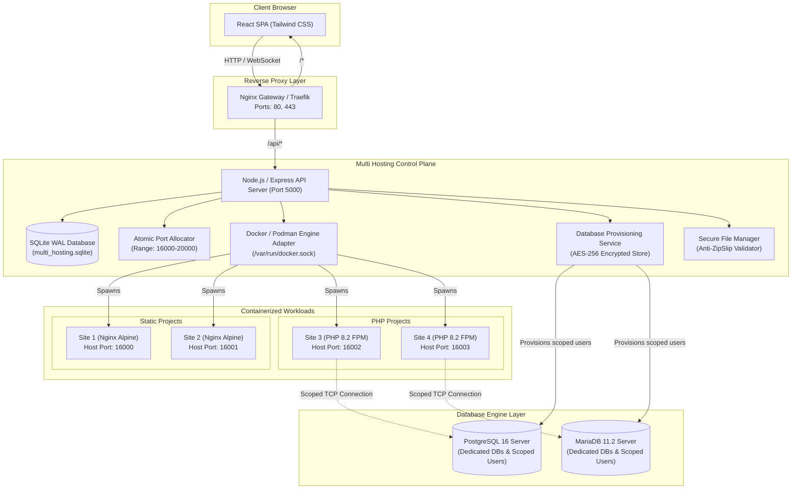

# Multi Hosting Platform Architecture 🏛️

Multi Hosting is structured as a decoupled, micro-containerized hosting control plane designed for high tenant isolation, automated resource allocation, and simple scalability.

---

## 1. System Architecture

---

## 2. Core Subsystems

### 🔌 Port Management System
1. **Allocation Range**: Configurable lower (`16000`) and upper (`20000`) bounds.
2. **Dual-Check Verification**:
   - **Database State**: Verifies port is not marked `ALLOCATED` or `RESERVED`.
   - **Host Socket Probe**: Actively tests TCP socket binding on `0.0.0.0:port` to ensure no host process occupies the port.
3. **Concurrency Locking**: Utilizes in-memory serialization mutexes and SQLite immediate transactions to guarantee that simultaneous website provisioning never receives duplicate ports.
4. **Lifecycle Synchronization**: Ports remain assigned while websites are running, stopped, or suspended. A port is released and made available for reallocation only when a project is deleted.

### 🗄️ Database Provisioning & Scoping
1. **Dedicated Database & User**: For every requested database, unique database names (e.g. `db_site_a_7f2b`) and usernames (`u_site_a_7f2b`) are generated.
2. **Strict Privilege Scoping**:
   - `REVOKE ALL ON DATABASE ... FROM PUBLIC`
   - `REVOKE ALL ON SCHEMA public FROM PUBLIC`
   - Scoped user is granted privileges ONLY to their assigned database and schema.
   - Users cannot connect to or list other tenant databases.
3. **Encryption at Rest**: Passwords are encrypted with **AES-256-GCM** using unique 96-bit initialization vectors and authentication tags.

### 📁 File Isolation & Zip-Slip Protection
1. **Sandboxed Root**: Each project is assigned an isolated directory `/data/projects/:id`.
2. **Path Sanitization**: Canonical path resolution strictly enforces that any read, write, upload, or deletion request resides strictly within the project directory.
3. **Zip-Slip Attack Prevention**: The archive extractor inspects all zip entry headers before extraction, rejecting any entry containing `..`, absolute paths, or null bytes.
