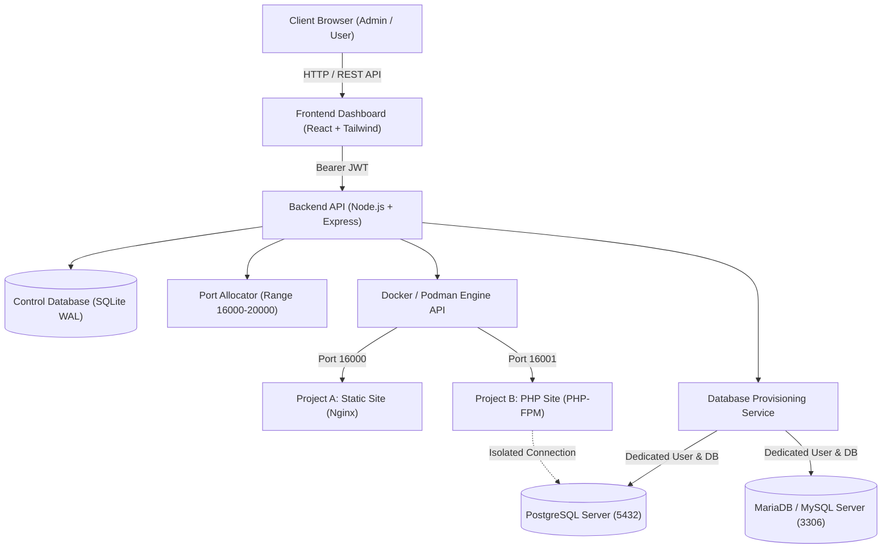

# Multi Hosting 🚀

A production-oriented, self-hosted web hosting platform and control panel engineered for provisioning and managing isolated static and PHP web applications, dedicated databases, and automated host port allocations.

---

## ✨ Key Features

- **🌐 Isolated Website Hosting**:
  - **Static Sites**: High-performance Nginx Alpine runtimes with gzip, caching, and security headers.
  - **PHP Applications**: PHP 8.2 FPM runtimes equipped with `pdo_pgsql`, `pdo_mysql`, `mysqli`, `curl`, `gd`, `zip`, and `opcache`.
  - Sandboxed volume mounts and non-root execution.
- **🔌 Dynamic Port Allocator**:
  - Automatically allocates unique host ports beginning at **`16000`** (configurable range `16000-20000`).
  - Active host TCP socket conflict detection and atomic database locking.
  - Ports are released safely only upon project deletion.
- **🗄️ Dedicated Database Provisioning**:
  - Automated creation of isolated PostgreSQL and MariaDB/MySQL databases and restricted user accounts.
  - Dedicated credentials stored with **AES-256-GCM** encryption at rest.
  - Live connection information, copyable CLI (`psql`/`mysql`) commands, PHP PDO code snippets, and `.env` configuration file export.
  - Secure password regeneration and database teardown.
- **📁 Integrated File Manager**:
  - Browse, edit, upload, create, and delete files directly from the browser.
  - In-browser Code Viewer/Editor with syntax highlighting and instant save.
  - **Anti-Zip-Slip Security**: Safe ZIP upload and auto-extraction preventing directory traversal attacks.
- **📊 Real-Time Monitoring & Logs**:
  - Live streaming container `stdout`/`stderr` logs with auto-refresh.
  - Host compute metrics: CPU load %, RAM usage %, disk capacity, and container uptime.
  - Admin Port Matrix visualizing in-use, free, and reserved ports.
- **🔒 Production Security Hardening**:
  - Role-Based Access Control (Administrator vs Regular User).
  - Argon2 / bcrypt password hashing (12 rounds) with progressive account lockout protection.
  - Centralized audit trails masking sensitive secrets.
  - Rate limiting and standard security headers.
  - OpenAPI 3.0 interactive documentation at `/api/docs`.

---

## 🏗️ Architecture Diagram



---

## ⚡ Quick Start

### 1. Prerequisites
- Docker (or Podman) and Docker Compose
- Node.js 20+ (for local development)

### 2. Single-Command Deployment (Docker Compose)
```bash
# Clone repository
cd multi-hosting

# Copy environment template
cp .env.example .env

# Start all services (Control Plane, Frontend, PostgreSQL, MariaDB)
docker compose up -d --build
```

### 3. Access Multi Hosting
- **Frontend Dashboard**: `http://localhost:3000` (or `http://YOUR_SERVER_IP:3000`)
- **Backend API & Swagger Docs**: `http://localhost:5000/api/docs`
- **Default Administrator Credentials**:
  - **Username**: `admin`
  - **Password**: `AdminPass123!Secure`

---

## 🧪 Automated Testing

Multi Hosting includes a test suite covering port concurrency, anti-traversal security, AES-256 cryptography, account lockout, and end-to-end REST operations:

```bash
cd backend
npm test
```

---

## 📚 Documentation Index

- [`ADMIN_SETUP.md`](ADMIN_SETUP.md) - Initial bootstrapping, admin capabilities, and user management.
- [`ARCHITECTURE.md`](ARCHITECTURE.md) - Deep dive into system architecture, container isolation, and data flows.
- [`SECURITY.md`](SECURITY.md) - Security policies, Anti-Zip-Slip validation, and credential encryption.
- [`DEPLOYMENT.md`](DEPLOYMENT.md) - Production server deployment guide for Ubuntu & Debian.
- [`BACKUP_RESTORE.md`](BACKUP_RESTORE.md) - Disaster recovery, database dumps, and restore workflows.
